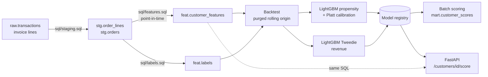
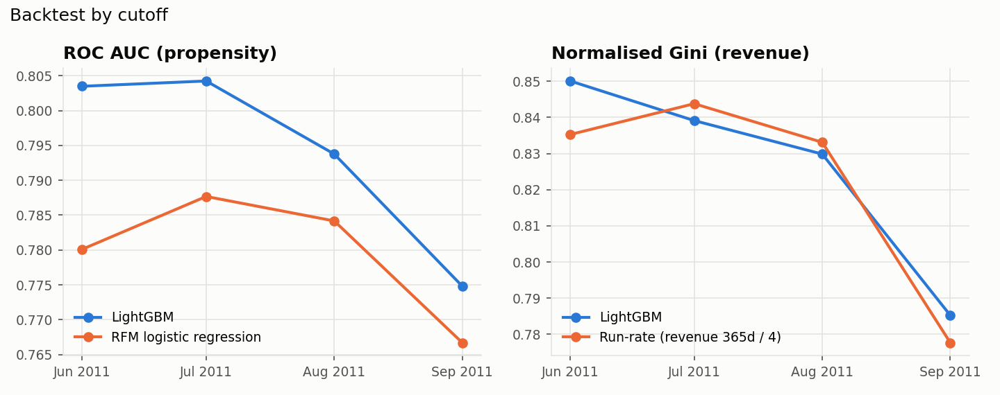
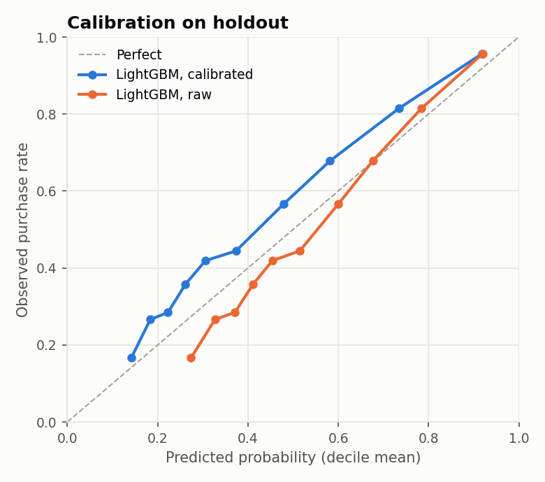
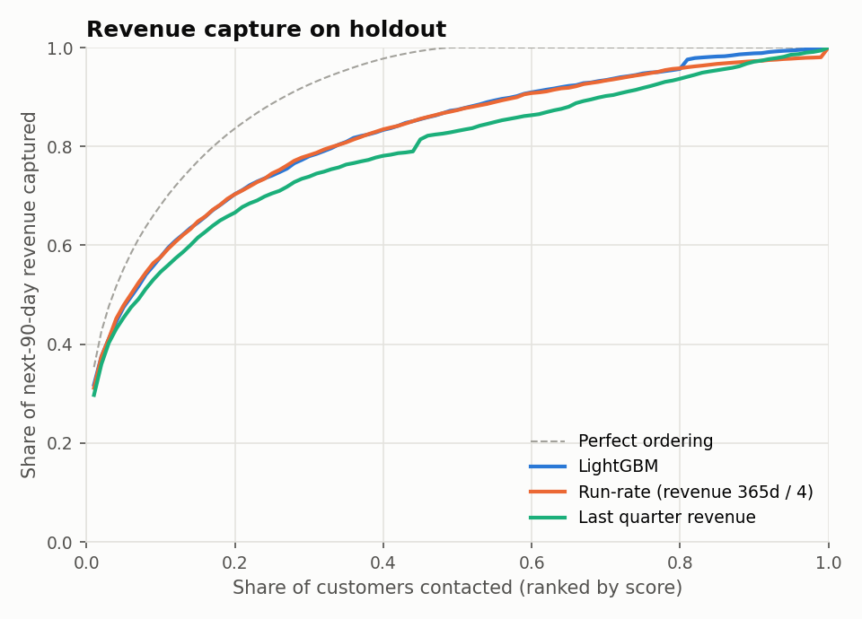
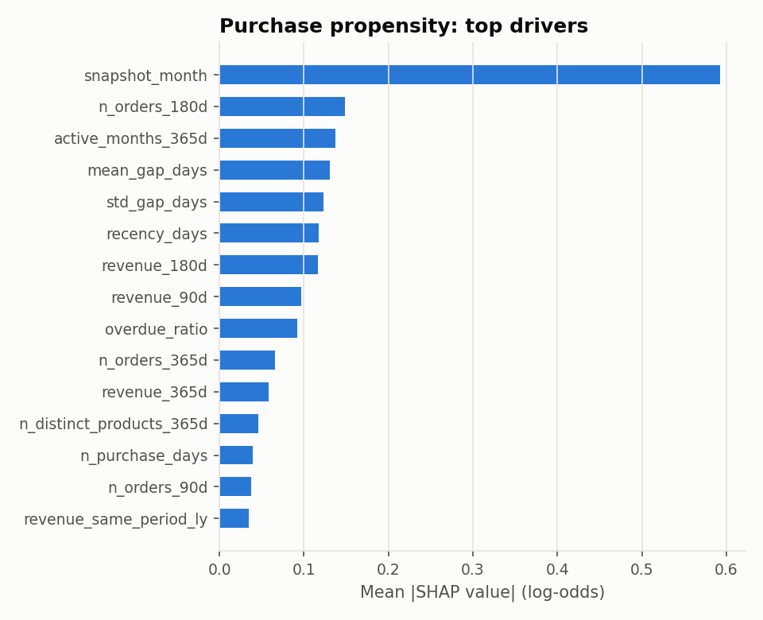
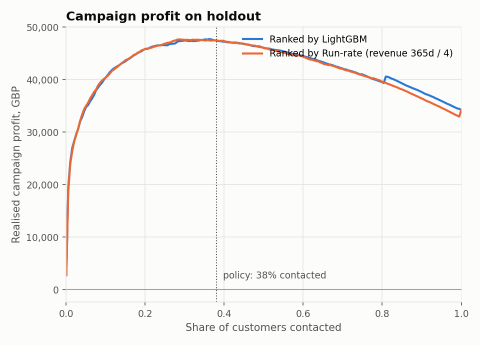

# Customer Value Forecasting

Predicts, for every active customer of an online wholesale retailer, the **probability of
purchasing in the next 90 days** and the **expected 90-day revenue**, and turns these into
a contact list for retention and upsell campaigns. Scores are written to a warehouse mart by
a batch job and served on demand through a REST API with per-customer explanations.

Built on 1.07M real invoice lines (UCI *Online Retail II*, Dec 2009 – Dec 2011, ~5.9K
customers, mostly B2B gift-ware resellers).

| | Model | Best baseline | |
|---|---|---|---|
| Purchase propensity, ROC AUC | **0.794** ± 0.014 | 0.780 (RFM logistic regression) | |
| Purchase propensity, log loss | **0.533** | 0.554 | |
| Calibration error (ECE) | **0.043** | 0.055 | |
| Revenue rank correlation (Spearman) | **0.549** | 0.524 (run-rate) | |
| Campaign profit on holdout | **£47.4K** contacting 38% of base | £34.2K contacting everyone | +38% |

*Mean ± std over a 4-cutoff rolling-origin backtest, each cutoff retraining the full
production procedure. Full report: [reports/model_report.md](reports/model_report.md).*

---

## How it works



1. **Staging (SQL, DuckDB).** Cleans invoice lines and aggregates them to orders.
2. **Feature store (SQL).** Monthly snapshots; for each snapshot and each customer with a
   purchase in the preceding 365 days, 31 features computed only from history strictly
   before the snapshot date.
3. **Labels (SQL).** `purchased` and net `revenue` over `[snapshot, snapshot + 90 days)`.
4. **Training.** Two LightGBM models with time-based early stopping, calibration and a refit
   on all eligible history.
5. **Backtest.** The exact training procedure is replayed at 4 historical cutoffs against
   baselines; the last cutoff is the holdout reported in the model registry.
6. **Scoring.** Batch scoring of the whole active base into `mart.customer_scores`, with
   reason codes, CRM segment, contact flag and a feature drift report; the API scores single
   customers with the same SQL template.

## Data

Source: [UCI Online Retail II](https://archive.ics.uci.edu/dataset/502/online+retail+ii),
downloaded by `cvf ingest`. Cleaning rules live in [sql/staging.sql](sql/staging.sql):

| Step | Rows |
|---|---:|
| Raw lines (two yearly sheets) | 1,067,371 |
| Drop sheet overlap 2010-12-01..09 (rows duplicated verbatim in both sheets) | 1,044,848 |
| Collapse exact duplicate lines | 1,033,034 |
| Drop lines without customer id (cannot be attributed) | 797,883 |
| Keep merchandise only: drop postage, Amazon fees, manual adjustments, bad-debt write-offs, samples, vouchers, zero-price stock moves | 794,161 |

Result: 43,876 orders (including cancellations) from 5,875 customers, £16.4M net revenue.

## Problem framing

* **Unit of prediction:** customer × monthly snapshot (2010-06 … 2011-09, 16 snapshots,
  62K rows). The scored population at a snapshot is every customer with a purchase in the
  previous 365 days.
* **Targets:** `purchased` — any non-cancelled order in the next 90 days (base rate 33–58%,
  strongly seasonal); `revenue` — net merchandise revenue in that window, floored at zero.
* **Point-in-time correctness:** features join orders with `invoice_ts < snapshot_date`.
  [tests/test_sql.py](tests/test_sql.py) appends future orders, cancellations and new
  customers and asserts the features are unchanged.
* **Features:** recency, tenure, order counts and revenue over 30/90/180/365-day windows,
  activity in the same 90-day period a year earlier (Q4 seasonality), inter-purchase gap
  statistics and an "overdue" ratio (recency / typical gap), basket size and breadth,
  cancellation rate, country, calendar month.

## Validation

Labels of a snapshot taken at `T` are observed until `T + 90d`, so neighbouring snapshots
overlap in time. Splits are **purged** ([src/cvf/splits.py](src/cvf/splits.py)):

```
cutoff C = 2011-09-01
train   : snapshots with T + 90d <= C            2010-06 … 2011-06  (refit)
  valid : last of them                           2011-06            (early stopping, calibration)
  fit   : snapshots with T + 90d <= valid        2010-06 … 2011-03
test    : snapshot at C                          2011-09            (labels to 2011-11-30)
```

The backtest repeats this at cutoffs 2011-06, -07, -08, -09. Hyper-parameter search
(Optuna, TPE, 40 trials) uses only inner folds whose labels close before the first backtest
cutoff, so tuning never touches test periods.

## Models

| Task | Model | Baselines |
|---|---|---|
| P(purchase in 90d) | LightGBM binary, Platt calibration on the validation snapshot | Logistic regression on log-RFM features |
| Revenue in 90d | LightGBM with Tweedie loss (p = 1.4) — handles the point mass at zero and the heavy right tail | Run-rate (revenue 365d / 4); last-quarter revenue |

## Results

Propensity — LightGBM beats the RFM logistic regression at every cutoff and is better
calibrated:



| | Calibration | Revenue capture |
|---|---|---|
| |  |  |

Top propensity drivers (mean |SHAP| on the holdout) are seasonality, purchase frequency over
the last 6 months, number of active months and the regularity of purchase gaps:



**Revenue: what the model does and does not add.** For the *amount* of next-quarter revenue,
a customer's own run-rate is a very strong predictor: revenue is concentrated in a few
large resellers whose spend is stable. The Tweedie model ranks the bulk of the base better
(Spearman 0.549 vs 0.524, Gini 0.826 vs 0.822) but does not beat run-rate on RMSE, which is
dominated by the largest accounts. A run-rate-offset model that can only learn corrections
to run-rate early-stops at almost zero trees, which confirms there is little systematic
signal left in the amount. The value of the model is the **probability** dimension and a
better ordering of mid-sized customers, not a better forecast for the top accounts.

## Campaign policy

Contacting a customer costs `contact_cost` (voucher + account manager time) and is assumed
to lift their purchase probability by `assumed_uplift`. Contact is worth it when

```
assumed_uplift × expected_revenue × gross_margin > contact_cost
```

i.e. expected 90-day revenue above £333 with the configured £10 / 10% / 30%.



On the holdout this contacts 38% of the base, which holds 82% of next-quarter revenue,
and yields £47.4K realised profit vs £34.2K for contacting everyone. The uplift is an
assumption in [configs/config.yaml](configs/config.yaml); it should be replaced with the
measured effect from a randomised holdout group in the first campaign.

Each scored customer also gets a CRM segment from trailing-year value and propensity
(`core`, `at_risk_high_value`, `active`, `dormant`). Scoring as of 2011-12-10:

| Segment | Customers | Mean P(purchase) | Expected revenue | Selected for contact |
|---|---:|---:|---:|---:|
| core | 875 | 0.80 | £1,210,706 | 694 |
| at_risk_high_value | 241 | 0.33 | £73,078 | 63 |
| active | 218 | 0.62 | £47,749 | 23 |
| dormant | 2,927 | 0.18 | £204,470 | 6 |

## Decision log

Reproduced by `cvf experiments` → [reports/experiments.md](reports/experiments.md).

| Decision | Evidence (backtest mean) |
|---|---|
| **Platt** instead of isotonic calibration | Log loss 0.534 vs 0.539 (isotonic) vs 0.552 (raw); ECE 0.045 vs 0.052 vs 0.088. Isotonic fitted on one month imposes that month's purchase rate on other seasons; Platt rescales log-odds and keeps the month effect the trees learned. |
| **Tweedie** single model over a hurdle model | Hurdle (calibrated P(buy) × gamma spend) has slightly higher Gini (0.833 vs 0.826) but under-forecasts total revenue by 16% (total ratio 0.84). The campaign budget is set from totals, so the unbiased model is preferred. |
| **Default revenue hyper-parameters** | Optuna improved inner-CV deviance by 6% but lowered backtest Gini (0.820 vs 0.826); tuning folds (Jan–Mar) do not represent the summer–autumn test season. Only the propensity search is applied ([configs/tuned_params.json](configs/tuned_params.json)). |
| **Snapshots from 2010-06**, despite only 6 months of history behind the earliest | Starting at 2010-12 (full 1-year look-back) gives similar propensity quality but the revenue model then never sees the autumn ramp-up and under-forecasts the holdout by 40% (total ratio 0.61). |

## Monitoring

Each model stores a reference profile (decile bins of every feature over the three most
recent training snapshots). Batch scoring computes the population stability index per
feature and logs warnings (PSI ≥ 0.10) and alerts (≥ 0.25); the report is saved to
`reports/scoring/drift_<date>.csv`. Calendar features are excluded. Scoring for 2011-12-10
alerts on recency and tenure — the expected pre-Christmas shift relative to a July–September
reference, and a reminder that the model has seen only one December.

## Running it

Requires Python 3.11+.

```bash
pip install -e ".[dev]"

cvf ingest        # download the source extract, load raw.transactions   (~1 min)
cvf build         # staging, feature store and labels                     (~2 s)
cvf tune          # optional: Optuna search -> configs/tuned_params.json  (~3 min)
cvf train         # backtest, fit, register model, write reports/          (~30 s)
cvf score         # score the active base into mart.customer_scores
cvf serve         # REST API on http://127.0.0.1:8000/docs
cvf experiments   # re-run the ablations in the decision log
```

`make all` runs ingest → build → train → score. Tests (`pytest`, ~5 s) cover SQL cleaning
rules, point-in-time correctness, label window boundaries, purged splits, metrics, policy,
drift, and an end-to-end run on synthetic transactions that checks the API returns the
same scores as the batch job.

### API

```bash
curl localhost:8000/customers/14646/score
```
```json
{
  "customer_id": 14646,
  "as_of": "2011-12-10",
  "p_purchase_90d": 0.98,
  "expected_revenue_90d": 58548.76,
  "segment": "core",
  "contact": true,
  "drivers": [
    {"feature": "active_months_365d", "value": 12.0, "impact": 0.76},
    {"feature": "n_orders_180d", "value": 45.0, "impact": 0.52},
    {"feature": "std_gap_days", "value": 7.48, "impact": 0.41}
  ],
  "model_version": "20261027T053350Z"
}
```

| Endpoint | |
|---|---|
| `GET /customers/{id}/score?as_of=YYYY-MM-DD` | On-demand score with top-3 SHAP drivers; any historical date |
| `GET /scores?segment=&contact=&limit=` | Latest batch scores, highest expected revenue first |
| `GET /model` | Model version, training window, holdout metrics, policy |
| `GET /health` | Liveness and loaded model version |

Docker: `docker build -t cvf . && docker run -p 8000:8000 -v $PWD/data:/app/data -v $PWD/artifacts:/app/artifacts cvf`

## Project layout

```
configs/            pipeline config, tuned hyper-parameters
sql/                staging, point-in-time features, labels (Jinja-templated DuckDB SQL)
src/cvf/
  ingest.py         source download and raw load
  features.py       feature store / labels / on-demand features
  splits.py         purged time splits
  models/           preprocessing, LightGBM + calibration, baselines
  training.py       shared fit procedure
  backtest.py       rolling-origin evaluation
  tuning.py         Optuna on inner folds
  evaluation.py     ranking, calibration and regression metrics
  policy.py         campaign economics, segments
  monitoring.py     PSI drift
  registry.py       versioned model bundles
  scoring.py        batch scoring, reason codes
  report.py         model report and figures
  experiments.py    ablations
  api/              FastAPI service
  cli.py            `cvf` command
tests/
reports/            model report, experiments, figures
```

## Limitations and next steps

* **Uplift is assumed, not measured.** The policy ranks by expected value; customers who
  buy anyway are contacted too. With a randomised control group from the first campaign the
  next step is an uplift (two-model or X-learner) ranking.
* **One year of seasonality.** Every calendar month appears at most twice in training; the
  December 2011 drift alert reflects that.
* **Left-censored history.** Data starts in December 2009, so tenure and lifetime totals are
  truncated for 2010 snapshots.
* **No product hierarchy.** Stock codes have no category; product-mix features (category
  share, new-collection adoption) would need a catalogue join.
